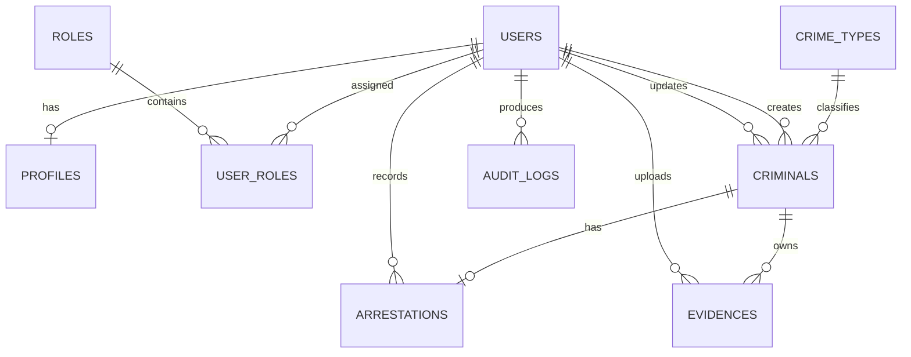
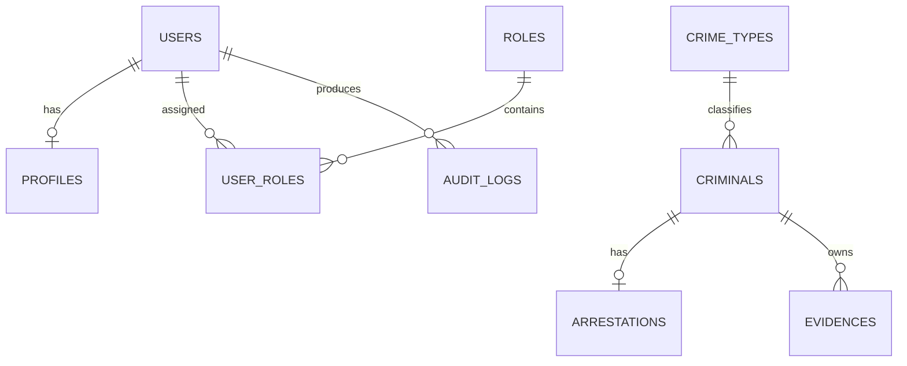
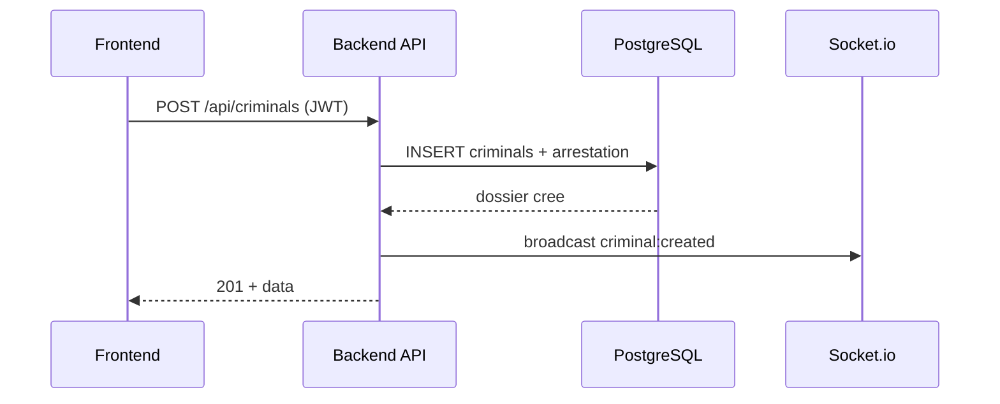

# Base de Donnees SGAC - Documentation Complete (MCD + MLD)

Date: 2026-02-27
Projet: securit-afrique-hub-main
SGBD: PostgreSQL
ORM: Prisma
Schema source: backend/prisma/schema.prisma

---

## 1) Objectif metier de la base

La base centralise:
- les utilisateurs (agents) et leurs roles/permissions,
- les dossiers criminels,
- les types de crimes,
- les pieces a conviction (avec preuves images),
- les donnees d'arrestation,
- l'audit des actions effectuees dans le systeme.

---

## 2) Conventions techniques

- Toutes les cles primaires sont des UUID (`String @id @default(uuid())`).
- Les dates de creation utilisent `now()`.
- Les dates de modification utilisent `@updatedAt`.
- Les suppressions en cascade existent sur certaines relations (ex: `profiles.user`, `evidences.criminal`, `arrestations.criminal`).
- Les statuts et severites sont stockes en `String` (pseudo-enums applicatifs).

---

## 3) MCD (Modele Conceptuel de Donnees)

### 3.1 Entites metier

- `User` (agent de securite)
- `Profile` (infos complementaires du User)
- `Role` (role fonctionnel)
- `UserRole` (association N:N User<->Role)
- `CrimeType` (referentiel des infractions)
- `Criminal` (dossier criminel)
- `Arrestation` (details d'interpellation d'un dossier)
- `Evidence` (piece a conviction d'un dossier)
- `AuditLog` (tracabilite des actions)

### 3.2 Relations et cardinalites

- `User` (1,1) -- (0,1) `Profile`
- `User` (1,N) -- (1,N) `Role` via `UserRole`
- `CrimeType` (1,1) -- (0,N) `Criminal`
- `User` (1,1) -- (0,N) `Criminal` [createdBy]
- `User` (1,1) -- (0,N) `Criminal` [updatedBy, optionnel]
- `Criminal` (1,1) -- (0,1) `Arrestation`
- `User` (1,1) -- (0,N) `Arrestation` [createdBy]
- `Criminal` (1,1) -- (0,N) `Evidence`
- `User` (1,1) -- (0,N) `Evidence` [createdBy]
- `User` (1,1) -- (0,N) `AuditLog`

### 3.3 Diagramme MCD (Mermaid)

---

## 4) MLD (Modele Logique de Donnees)

Notation:
- PK = Primary Key
- FK = Foreign Key
- UQ = Unique
- IDX = Index
- NN = Not Null

### 4.1 Table `users`

- `id` (PK, UUID, NN)
- `username` (TEXT, NN, UQ)
- `email` (TEXT, NN, UQ)
- `password` (TEXT, NN) - hash du mot de passe
- `isActive` (BOOLEAN, NN, default true)
- `createdAt` (TIMESTAMP, NN, default now)
- `updatedAt` (TIMESTAMP, NN, auto update)

Relations:
- 0..1 `profiles`
- 0..N `user_roles`
- 0..N `audit_logs`
- 0..N `criminals` (createdBy)
- 0..N `criminals` (updatedBy)
- 0..N `evidences` (createdBy)
- 0..N `arrestations` (createdBy)

### 4.2 Table `profiles`

- `id` (PK, UUID, NN)
- `userId` (FK -> users.id, NN, UQ)
- `firstName` (TEXT, NN)
- `lastName` (TEXT, NN)
- `phoneNumber` (TEXT, NULL)
- `service` (TEXT, NULL)
- `grade` (TEXT, NULL)
- `photo` (TEXT, NULL)
- `createdAt` (TIMESTAMP, NN, default now)
- `updatedAt` (TIMESTAMP, NN, auto update)

Regle:
- `onDelete: Cascade` depuis `users`.

### 4.3 Table `roles`

- `id` (PK, UUID, NN)
- `name` (TEXT, NN, UQ)
- `description` (TEXT, NULL)
- `permissions` (JSON, NN)
- `createdAt` (TIMESTAMP, NN, default now)
- `updatedAt` (TIMESTAMP, NN, auto update)

### 4.4 Table `user_roles`

- `id` (PK, UUID, NN)
- `userId` (FK -> users.id, NN)
- `roleId` (FK -> roles.id, NN)
- `assignedAt` (TIMESTAMP, NN, default now)

Contraintes:
- UQ composite (`userId`, `roleId`).
- Cascade delete depuis `users` et `roles`.

### 4.5 Table `crime_types`

- `id` (PK, UUID, NN)
- `name` (TEXT, NN, UQ)
- `code` (TEXT, NN, UQ)
- `description` (TEXT, NULL)
- `severity` (TEXT, NN)
- `createdAt` (TIMESTAMP, NN, default now)
- `updatedAt` (TIMESTAMP, NN, auto update)

### 4.6 Table `criminals`

- `id` (PK, UUID, NN)
- `caseNumber` (TEXT, NN, UQ)
- `firstName` (TEXT, NN)
- `lastName` (TEXT, NN)
- `alias` (TEXT, NULL)
- `dateOfBirth` (TIMESTAMP, NULL)
- `placeOfBirth` (TEXT, NULL)
- `nationality` (TEXT, NULL)
- `gender` (TEXT, NULL)
- `photo` (TEXT, NULL)
- `fingerprint` (TEXT, NULL)
- `crimeTypeId` (FK -> crime_types.id, NN)
- `crimeDate` (TIMESTAMP, NULL)
- `crimeLocation` (TEXT, NULL)
- `description` (TEXT, NN)
- `status` (TEXT, NN, default `ACTIVE`)
- `dangerLevel` (TEXT, NULL)
- `lastKnownAddress` (TEXT, NULL)
- `phoneNumber` (TEXT, NULL)
- `createdById` (FK -> users.id, NN)
- `updatedById` (FK -> users.id, NULL)
- `createdAt` (TIMESTAMP, NN, default now)
- `updatedAt` (TIMESTAMP, NN, auto update)

Indexes:
- IDX `caseNumber`
- IDX (`firstName`, `lastName`)
- IDX `crimeTypeId`
- IDX `status`

Relations:
- 0..N `evidences`
- 0..1 `arrestation`

### 4.7 Table `arrestations`

- `id` (PK, UUID, NN)
- `criminalId` (FK -> criminals.id, NN, UQ)
- `arrestDate` (TIMESTAMP, NULL)
- `arrestLocation` (TEXT, NULL)
- `arrestingUnit` (TEXT, NULL)
- `arrestingOfficer` (TEXT, NULL)
- `warrantNumber` (TEXT, NULL)
- `notes` (TEXT, NULL)
- `createdById` (FK -> users.id, NN)
- `createdAt` (TIMESTAMP, NN, default now)
- `updatedAt` (TIMESTAMP, NN, auto update)

Indexes:
- IDX `createdById`

Regles:
- `criminalId` unique -> 1 seule fiche arrestation par dossier criminel.
- `onDelete: Cascade` depuis `criminals`.

### 4.8 Table `evidences`

- `id` (PK, UUID, NN)
- `criminalId` (FK -> criminals.id, NN)
- `title` (TEXT, NULL)
- `description` (TEXT, NULL)
- `fileUrls` (TEXT[], NN)
- `createdById` (FK -> users.id, NN)
- `createdAt` (TIMESTAMP, NN, default now)

Indexes:
- IDX `criminalId`
- IDX `createdById`

Regles:
- Plusieurs pieces possibles pour un meme dossier.
- `onDelete: Cascade` depuis `criminals`.

### 4.9 Table `audit_logs`

- `id` (PK, UUID, NN)
- `userId` (FK -> users.id, NN)
- `action` (TEXT, NN)
- `entity` (TEXT, NN)
- `entityId` (TEXT, NULL)
- `changes` (JSON, NULL)
- `ipAddress` (TEXT, NULL)
- `userAgent` (TEXT, NULL)
- `timestamp` (TIMESTAMP, NN, default now)

Indexes:
- IDX `userId`
- IDX `entity`
- IDX `timestamp`

---

## 5) Domaines de valeurs (regles metier applicatives)

### 5.1 Criminal.status
Valeurs utilisees par l'application:
- `ACTIVE` (recherche)
- `ARRESTED` (arrete)
- `RELEASED` (libere)
- `DECEASED` (decede)
- `UNKNOWN` (etat non precise)

### 5.2 Criminal.gender
- `MALE`, `FEMALE`, `OTHER`

### 5.3 Criminal.dangerLevel / CrimeType.severity
- `LOW`, `MEDIUM`, `HIGH`, `CRITICAL`

### 5.4 Audit.action
- `CREATE`, `UPDATE`, `DELETE`, `LOGIN`, `LOGOUT`

---

## 6) Regles d'integrite importantes

- Un `Profile` ne peut pas exister sans `User`.
- Un `Criminal` doit avoir un `CrimeType` valide et un createur (`createdById`).
- Une `Arrestation` est liee a un seul `Criminal` (unicite `criminalId`).
- Une `Evidence` doit etre liee a un `Criminal` et a un `User` createur.
- Les associations role-utilisateur sont dedoublonnees par `UNIQUE(userId, roleId)`.

Note applicative:
- Meme si le schema permettrait techniquement certaines suppressions par cascade, le backend actuel desactive la suppression des dossiers criminels (politique de conservation et tracabilite).

---

## 7) MLD relationnel synthetique

- `users(id PK, username UQ, email UQ, ... )`
- `profiles(id PK, userId FK UQ -> users.id, ... )`
- `roles(id PK, name UQ, permissions JSON, ... )`
- `user_roles(id PK, userId FK -> users.id, roleId FK -> roles.id, UQ(userId, roleId), ... )`
- `crime_types(id PK, name UQ, code UQ, severity, ... )`
- `criminals(id PK, caseNumber UQ, crimeTypeId FK -> crime_types.id, createdById FK -> users.id, updatedById FK -> users.id NULL, ... )`
- `arrestations(id PK, criminalId FK UQ -> criminals.id, createdById FK -> users.id, ... )`
- `evidences(id PK, criminalId FK -> criminals.id, createdById FK -> users.id, fileUrls TEXT[], ... )`
- `audit_logs(id PK, userId FK -> users.id, action, entity, changes JSON, timestamp, ... )`

---

## 8) Cartographie donnees applicatives importantes

- Les images physiques sont stockees dans `backend/uploads/...`
  - Photos criminels: `uploads/photos/`
  - Pieces a conviction: `uploads/evidences/`
- La base ne stocke que les chemins/URLs (attributs `photo`, `fileUrls`).

---

## 9) Evolutions recentes integrees

- Ajout de `Evidence` (pieces a conviction).
- Ajout de `Arrestation` (fiche d'interpellation).
- Ajout du statut `RELEASED`.
- Retrait de la suppression de criminel dans les routes API.

---

## 10) Recommandations d'evolution

- Convertir les pseudo-enums string en enums PostgreSQL/Prisma pour renforcer l'integrite.
- Ajouter des contraintes CHECK sur les valeurs metier critiques (`status`, `severity`, `gender`).
- Ajouter une table d'historique des statuts de dossier (timeline judiciaire).
- Ajouter un versionning des pieces a conviction si modification autorisee.

---

## 11) Guide pratique pour creer les differents diagrammes

Objectif: partir du schema Prisma existant et produire des diagrammes exploitables par une equipe projet.

### 11.1 MCD (conceptuel metier)
- Outil conseille: diagrams.net (draw.io) ou Mermaid.
- Niveau de detail: entites metier + cardinalites, sans details SQL.
- Entites a garder: `User`, `Profile`, `Role`, `UserRole`, `CrimeType`, `Criminal`, `Arrestation`, `Evidence`, `AuditLog`.
- Cardinalites a afficher en priorite:
  - User 1..1 -> 0..1 Profile
  - User N..N Role via UserRole
  - CrimeType 1..1 -> 0..N Criminal
  - Criminal 1..1 -> 0..1 Arrestation
  - Criminal 1..1 -> 0..N Evidence
  - User 1..1 -> 0..N AuditLog

### 11.2 MLD (logique relationnel)
- Outil conseille: dbdiagram.io ou Mermaid ER.
- Niveau de detail: tables, PK/FK/UQ, index, types logiques.
- Inclure:
  - cles primaires UUID
  - FK avec sens de relation
  - contraintes d'unicite (`users.username`, `users.email`, `criminals.caseNumber`, etc.)
  - tables d'association (`user_roles`)

### 11.3 MPD (physique PostgreSQL)
- Outil conseille: DBeaver, pgAdmin ERD, SchemaSpy.
- Niveau de detail: types PostgreSQL reels, index, policies de suppression, colonnes JSON/ARRAY.
- A verifier:
  - `roles.permissions` en JSON
  - `evidences.fileUrls` en TEXT[]
  - indexes `criminals(status, crimeTypeId, caseNumber)`
  - performances de `audit_logs(timestamp, userId)`

### 11.4 Diagramme de flux applicatif (recommande)
- Type: diagramme de sequence.
- Cas a modeliser:
  - Authentification: Frontend -> /auth/login -> JWT -> stockage token.
  - Creation dossier: Frontend -> /criminals -> DB + websocket broadcast.
  - Upload preuve: Frontend -> /criminals/:id/evidences -> stockage fichiers + DB.

### 11.5 Workflow de production des diagrammes
1. Verrouiller le schema source (`backend/prisma/schema.prisma`).
2. Generer MLD de reference depuis Prisma.
3. Deriver MCD pour presentation metier (version simplifiee).
4. Produire MPD PostgreSQL pour exploitation technique.
5. Versionner les diagrammes dans `/docs/diagrams` (source + export PNG/PDF).

---

## 12) Templates Mermaid prets a copier

### 12.1 MCD simplifie

### 12.2 Sequence: creation d'un dossier

